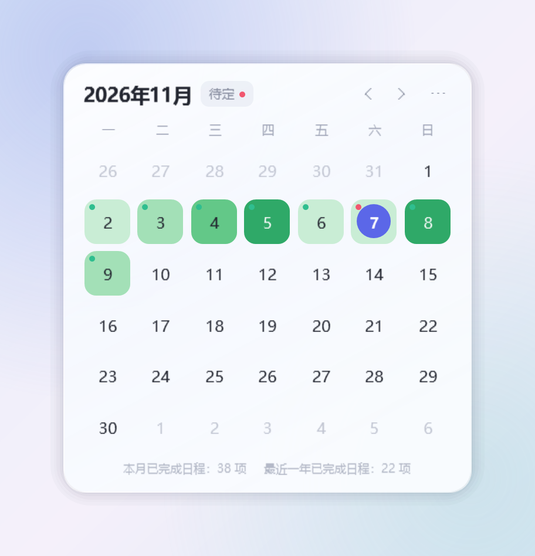
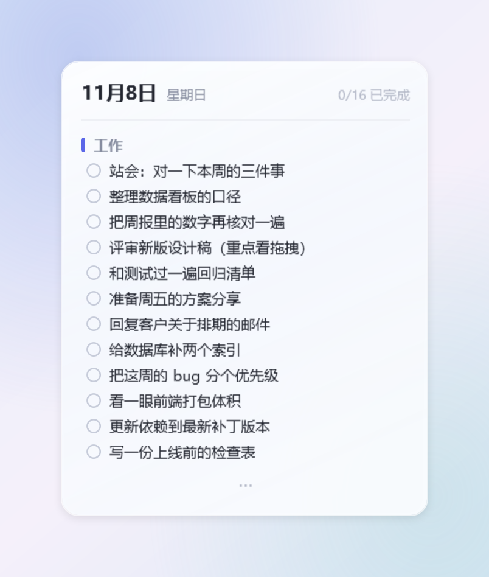
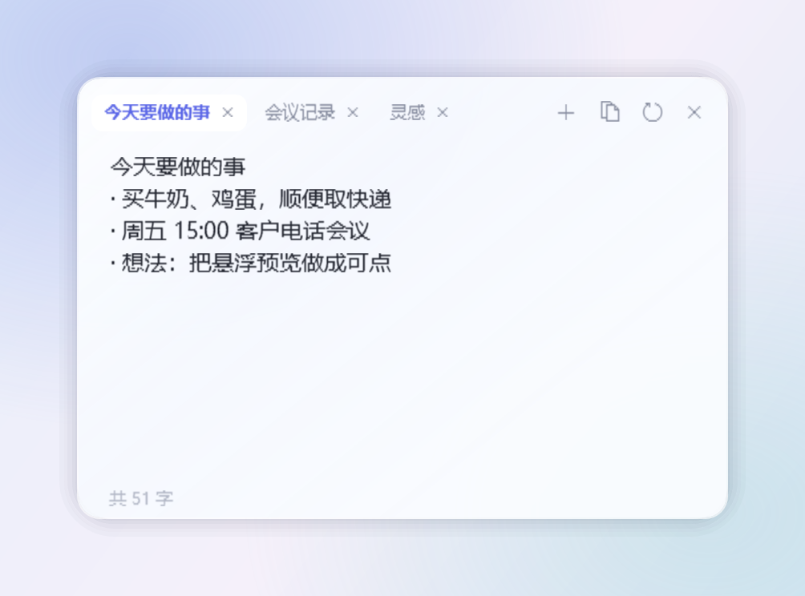
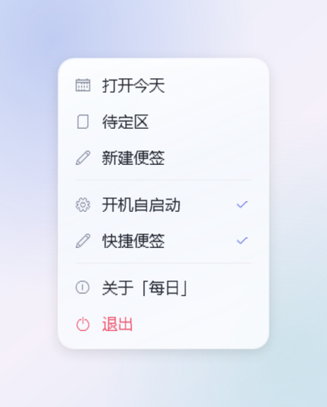

<div align="center">

# 每日 · MeiRi

**贴在桌面上的日历、日程与随手便签**

Windows 10 / 11 · C# 12 · .NET 8 · WPF · 零第三方依赖

[](#快速开始)
[](#从源码构建)
[](LICENSE)
[](MeiRi.csproj)


</div>

> **English** — MeiRi is a small calendar that lives on your Windows desktop. Each day is
> shaded by how many tasks you finished (like a GitHub contribution graph), a click opens that
> day's tasks with groups and notes, unscheduled work waits in a backlog you can drag onto a
> date, and double-clicking the taskbar pops up a sticky note. C# 12 / .NET 8 / WPF, no
> third-party packages, ~55 MB private memory and 0 % CPU when idle.

## 它是什么

一块可以随时点开的桌面日历：**看着舒服、记起来不费劲**。没有账号、没有云同步、没有广告，
所有数据都在本机的一个文件里。

- **一眼看懂**：哪天做了多少事，颜色深浅直接画在日期上。
- **点开就记**：`Enter` 保存、`Ctrl+Enter` 换行，改措辞不会误删完成状态。
- **随手就写**：双击任务栏空白处，弹出一张便签，写完关掉不留痕迹。

## 截图

<table>
  <tr>
    <td align="center"><br/>
      <sub><b>桌面日历</b> · 绿色深浅 = 当天完成的日程数，右上角小点提醒待定区</sub></td>
    <td align="center"><br/>
      <sub><b>日程编辑</b> · 无类别日程在上，类别分组在下，每条可挂一行备注</sub></td>
  </tr>
  <tr>
    <td align="center"><br/>
      <sub><b>悬浮预览</b> · 鼠标停在某天即可看当天安排，放不下用 <code>···</code> 提示</sub></td>
    <td align="center"><br/>
      <sub><b>随手便签</b> · 双击任务栏弹出，多栏、可合并，左下角实时字数</sub></td>
  </tr>
  <tr>
    <td align="center"><br/>
      <sub><b>待定区</b> · 还没排期的先放这里，拖到日历某天即完成排期</sub></td>
    <td align="center"><br/>
      <sub><b>菜单</b> · 自绘玻璃卡片，和整体风格一致</sub></td>
  </tr>
</table>

## 功能

- **日历就在桌面**：不占任务栏、不进 `Alt+Tab`，点一下回到最前；每个显示器一块，拖动任意一块全部同步。
- **热力图**：完成 1–2 项浅绿、3–4 项中绿、5–7 项深绿、8 项以上最深；日期左上角红点 = 有未完成，绿点 = 全部完成。
- **统计**：底部常驻「本月 / 最近一年已完成日程」，只在数据变化时重算一次。
- **点开一天就记**：单击打开当日编辑窗，再单击收起；`Enter` 保存、`Ctrl+Enter` 换行、`Esc` 撤销。
- **只点圆圈才算完成**，点文字是编辑——想改措辞时不会手滑把日程划掉。
- **类别分组**：点类别块的空白处以选中，之后新增的日程直接归到该组；类别可改名、删除、拖动排序。
- **备注**：每条日程可挂一行灰色小注，编辑窗与「复制当日日程」会带上它。
- **悬浮预览**：鼠标停在某天，右上角对齐鼠标弹出当日摘要；纯只读、点击穿透、不显示滚动条。
- **待定区**：未排期的任务先放这里，拖到日历某天即排期，反向拖回去也成立。
- **拖拽**：同类别排序、跨类别移动、拖到日历换日期，全程有玻璃浮卡、插入指示线与落点高亮。
- **随手便签**：双击任务栏空白处弹出；多栏标签、可拖拽合并、可缩放，复制/剪切/粘贴与系统行为一致。
- **开机自启**：首次运行自动登记（`HKCU\…\Run`），菜单里可随时关掉。

## 快速开始

**需要**：Windows 10 1809+ / Windows 11，以及 [.NET 8 SDK](https://dotnet.microsoft.com/download/dotnet/8.0)
（只想运行、不想编译的话装「桌面运行时」即可，见方式三）。

### 方式一：拉源码，一条命令跑起来

```powershell
git clone https://github.com/qwangxiang/MeiRi.git
cd MeiRi
dotnet run
```

没有装 Git？在仓库页面点 **Code → Download ZIP**，解压后在解压出来的 `MeiRi` 目录里执行 `dotnet run`。

### 方式二：打包成一个文件夹，以后双击运行

```powershell
dotnet publish -c Release -r win-x64 --self-contained false -p:PublishReadyToRun=true -o app
.\app\MeiRi.exe
```

生成的 `app\` 目录可以整个复制到任何有 .NET 8 桌面运行时的电脑上，双击 `MeiRi.exe` 就用。

### 方式三：打包成免安装、免运行时的单目录

```powershell
dotnet publish -c Release -r win-x64 --self-contained true -o app-standalone
```

`app-standalone\MeiRi.exe` 自带运行时（约 150 MB），复制到别的 Windows 电脑上也能直接双击。

> 第一次运行若出现 SmartScreen 提示，点「更多信息 → 仍要运行」即可。
> 程序默认开机自启，可在日历 `⋯` 菜单里关掉；数据都在程序目录的 `Data\` 里，整个文件夹删掉就是卸载。

## 常用操作

| 想做什么 | 怎么做 |
| --- | --- |
| 打开某一天 | 单击日历上的日期（再单击同一天收起） |
| 修改日程文字 | 单击文字就地编辑，`Enter` 保存、`Esc` 撤销 |
| 标记完成 | 只点左侧那个圆圈 |
| 换行 | `Ctrl+Enter` |
| 看当天摘要 | 鼠标悬停在某一天上 |
| 打开待定区 | 日历标题旁的 `待定` |
| 新建便签 | 双击任务栏空白处（可在菜单里关闭此功能） |
| 移动日历 | 按住顶部月份区域拖动 |
| 打开菜单 / 退出 | 右上角 `⋯` 或右键日历 |

完整说明见 **[使用指南](docs/guide.md)**。

## 数据与隐私

- 全部数据放在程序目录的 `Data\` 里：`schedule.dat`（日程，紧凑二进制，原子写入 + `.bak` 备份）、
  `settings.json`（设置）、`meiri.log`（运行日志）。
- **不联网、无遥测、无账号**。删掉 `Data\` 就是清空重来。

## 项目结构

```
Core\          剪贴板、窗口效果、菜单浮窗、开发自检
Interop\       Win32 / 任务栏 / 虚拟桌面 / 显示器
Models\        DayData、TodoItem、Category
Services\      数据存储、设置、便签管理、全局鼠标钩子
ViewModels\    日历视图模型
Views\         日历、日程编辑、待定区、悬浮预览、便签
Theme\         配色、控件样式、玻璃卡片
docs\          使用指南、设计笔记、截图
```

设计取舍与性能数据见 **[设计笔记](docs/architecture.md)**。

## 开发自检

程序内置一组只在开发时使用的开关（加在 `MeiRi.exe` 后面），便于在没人看着屏幕的情况下核对行为：

| 开关 | 作用 |
| --- | --- |
| `--diag` | 每 10 秒往日志写一次内存 / 窗口统计 |
| `--shot <目录>` | 把各窗口离屏渲染成 PNG |
| `--gallery <目录>` | 用内置假数据重新生成 README 里的截图（2 倍分辨率） |
| `--ui` | 用合成鼠标/键盘逐项自检交互，并存抓屏 |
| `--clip` | 反复 `Ctrl+X`，验证剪切不会半成功、粘贴后光标位置与字数 |
| `--typing` | 量便签每次按键与每帧的耗时 |

其余开关（`--drop` `--drag` `--frames` `--stack` `--probe` `--preview` `--taskbar` `--flyout`）
见[设计笔记](docs/architecture.md#开发自检开关)。

## 已知限制

- 便签是临时草稿，**关闭后不保留**（按「清空」也不会留副本）。
- 日历是普通窗口，被其他窗口盖住时点一下回到最前，不再常驻桌面底层。
- 悬浮预览按设计只给一眼：日期、类别、每条日程一行，**不显示备注**。
- 日程编辑窗与待定区依附日历，不能自由拖动。
- 数据为单文件全量保存，适合个人日程量级（数万条以内无压力）。

## 许可证

[MIT](LICENSE) © 2026 qwangxiang
