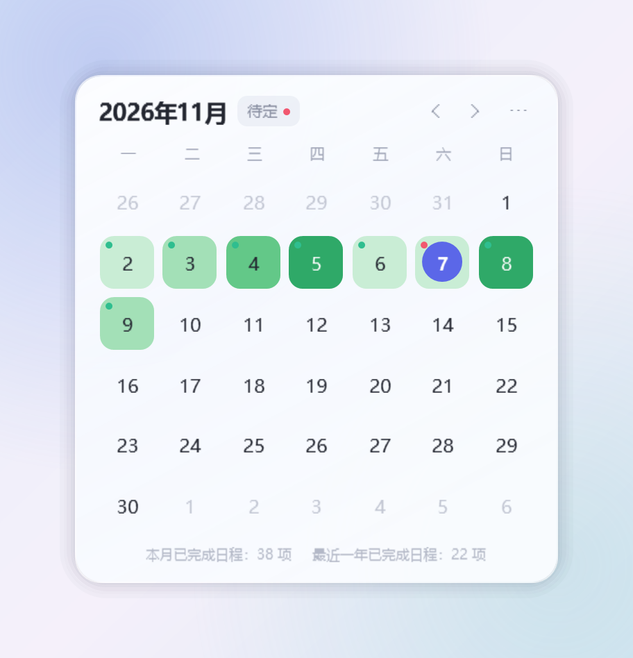
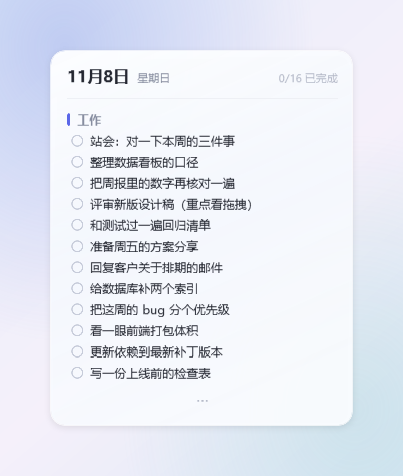
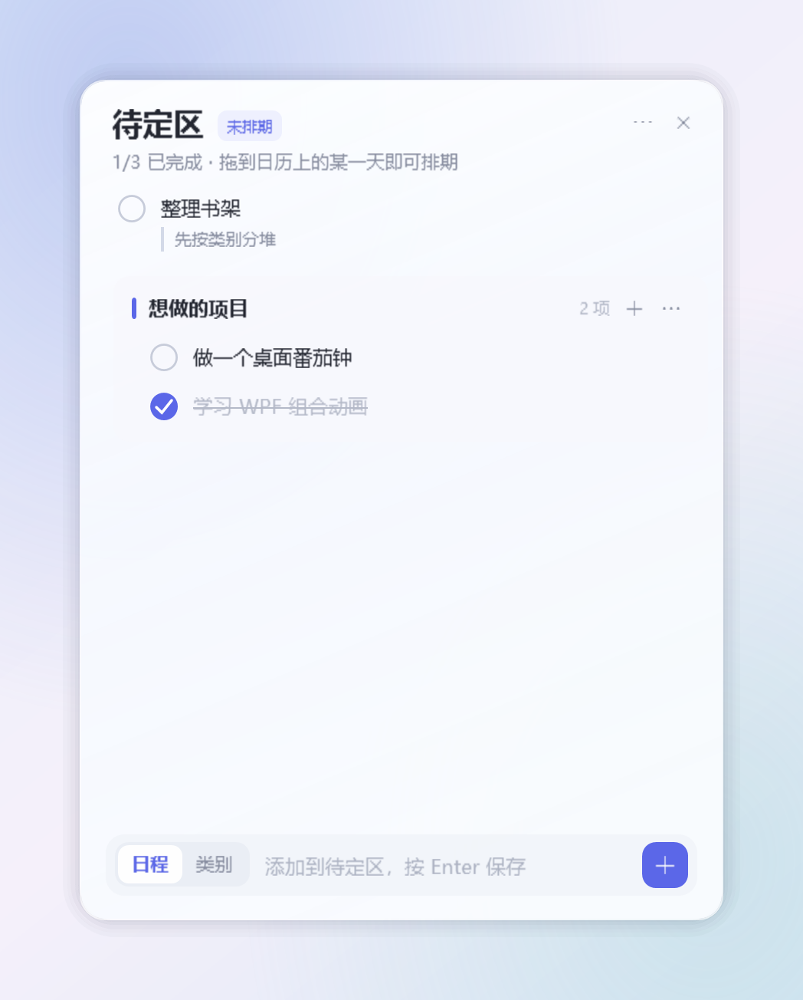
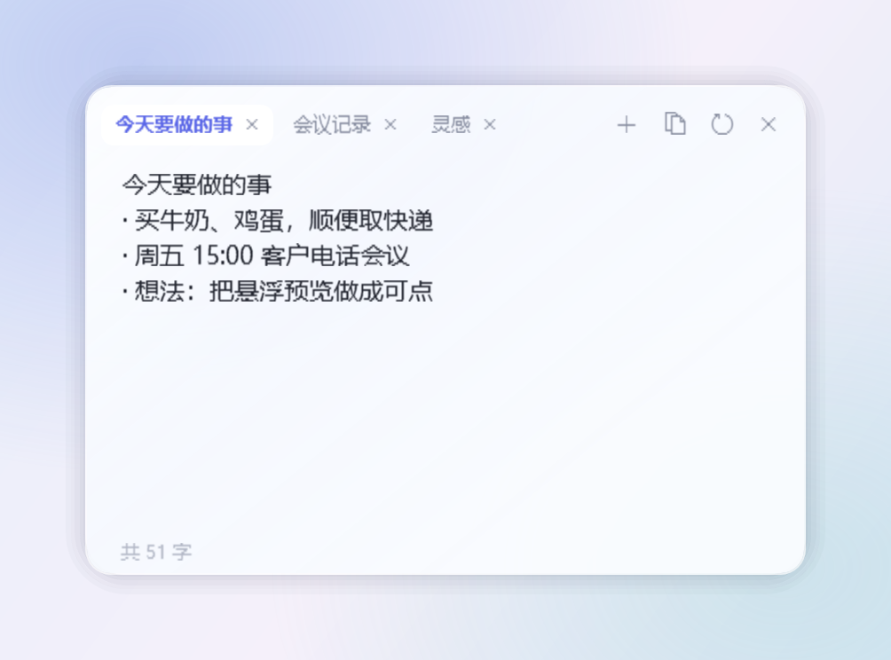

# 使用指南

> 面向使用者的完整说明。想了解实现思路请看[设计笔记](architecture.md)。

## 目录

- [启动与退出](#启动与退出)
- [桌面日历](#桌面日历)
- [日程编辑窗](#日程编辑窗)
- [类别](#类别)
- [备注](#备注)
- [悬浮预览](#悬浮预览)
- [待定区](#待定区)
- [拖拽](#拖拽)
- [随手便签](#随手便签)
- [窗口层级与位置](#窗口层级与位置)
- [数据文件](#数据文件)
- [常见问题](#常见问题)

## 启动与退出

- 双击 `MeiRi.exe` 启动，日历出现在上次的位置。
- **开机自启动**默认开启（写入 `HKCU\Software\Microsoft\Windows\CurrentVersion\Run`），
  在 `⋯` 菜单里可以随时取消。
- 再次运行 `MeiRi.exe`（已在运行时）会**直接新建一张便签**，不会开第二个日历。
- 退出：日历右上角 `⋯` → **退出**。退出不会删除任何数据。

## 桌面日历

- 每块显示器一块日历。**按住顶部月份区域拖动**，所有屏幕的日历一起移动。
- 拔插显示器、改分辨率后日历会自动重建，不会留下错位的窗口。
- `‹` `›` 翻月，`回到今天` 回到本月（只在不是本月时出现）。
- **绿色深浅 = 当天完成的日程数量**：

  | 完成数 | 1–2 | 3–4 | 5–7 | 8+ |
  | --- | --- | --- | --- | --- |
  | 颜色 | 浅绿 | 中绿 | 深绿 | 最深（自动切白字） |

- 日期**左上角状态点**：红点 = 有未完成日程，绿点 = 全部完成，没有日程则不显示。
- 标题右侧 **`待定`**：待定区里有未完成任务时带一个小红点。
- 底部一行小字：**本月已完成日程 / 最近一年已完成日程**（本月按日历月、最近一年按滚动 365 天，
  统计对象是「打了勾的日程」）。

## 日程编辑窗

- **单击**日历上的某一天打开，**再单击同一天收起**；点别的日期，卡片原地不跳、只换内容。
- 顶部是**无类别日程**，下面按**类别**分组，日程缩进在类别之下。
- **单击日程文字**就地修改（`Enter` 保存、`Esc` 撤销、点别处自动保存）。
- **只有点左侧圆圈才切换完成状态**；点文字、点条目空白处都是编辑。
- 完成后条目顺序不变，只加删除线与勾选。
- 输入框左侧切换「日程 / 类别」，回车即添加；提交后输入框清空并保持焦点，可以连续录入。
- 右上角 `⋯` 菜单：复制当日日程、清空已完成等。

## 类别

- 点击类别块的**边框空白处**（标题以外、日程行以外）即可选中/取消该类别，
  选中后新日程直接加到该类别末尾，不必再去点右上角的 `+`。
- 选中状态是该块的淡色底 + 描边。
- 单击类别标题改名，`⋯` 菜单可以删除类别（类别内的日程一并删除）。
- 类别之间可以拖动排序。

## 备注

- 每条日程右侧有**备注按钮（铅笔）**：点击后在条目下方展开输入框，`Enter` 保存、`Esc` 撤销。
- 保存后以**小一号灰色字体 + 左侧细竖线**显示在日程下方。
- 编辑窗与「复制当日日程」会带上备注，**悬浮预览不带**。

## 悬浮预览

- 鼠标停在某一天上即弹出，只读。
- 内容：**日期 + 星期**、完成进度、类别名与**每条日程一行**，超长自动省略。
- 当天没有日程就不出现。
- 放不下时底部出现一排 **`···`**，**不会出现滚动条**（浮窗点击穿透，滚动条本来也拖不动）。
- 浮窗右上角对齐鼠标位置；右侧空间不足时自动镜像到鼠标左侧。

## 待定区

- 日历标题旁 `待定` 打开，再点一次收起。
- 和某一天的编辑窗**互斥**：打开一个会自动收起另一个。
- 结构、增删改、备注、排序都和编辑窗一致，只是没有日期。
- **把待定区里的日程或类别拖到日历的某一天**即完成排期；
  日程会继承原类别，目标日有同名类别时（忽略大小写与首尾空格）合并到该类别。
- 反向也成立：把日程/类别从编辑窗拖到待定区，就变成「以后再说」。

## 拖拽

- 拖动日程：同类别内排序、跨类别移动、拖到顶部变回无类别。
- 拖动类别：调整类别之间的顺序。
- 拖出编辑窗、落到日历某一天：整条日程 / 整个类别移到那天。
- 拖动时使用跟随鼠标的玻璃浮卡片与插入指示线，落点即时高亮。
- 拖出卡片时卡片整体淡到几乎透明（约 14 %），被挡住的窗口直接成为拖动目标，松手即落；
  拖回卡片内则恢复不透明、继续在本窗内排序。

## 随手便签

- **总开关**：`⋯` → **快捷便签**（状态记在 `Data\settings.json`）。关掉后双击任务栏不再弹便签，
  菜单里的「新建便签」也会隐藏，已打开的便签会被收起。
- 在**任务栏空白处左键双击**，在鼠标位置弹出便签（会自动贴到任务栏上方）。
  双击已打开软件的图标、固定图标、托盘图标或开始按钮都**不会**弹便签。
- 便签显示在任务栏，点任务栏按钮可重新打开/置顶；便签已在前台时再点会最小化，再点还原。
- 顶部是**分页栏**：右侧 `+` 在当前窗口加一栏，每栏末尾的 `×` 单独关闭这一栏，关掉最后一栏窗口才消失。
- 右上角：复制全部、清空、关闭；可多开、可拖动、右下角可缩放。
- **剪切 / 复制 / 粘贴**：`Ctrl+X` `Ctrl+C` `Ctrl+V`，右键也是同一套玻璃浮窗。
  - 剪切**只有在剪贴板真的收到文字之后才删除**选区；剪贴板被别的程序占用时先保留文字并提示，
    1 秒内自动重试（最多 3 次），失败就明确说「内容没动」，不会出现半成功状态。
  - **粘贴后光标停在被粘贴内容的末尾**，接着打字不会有意外。
- **左下角字数**：常态 `共 N 字`；选中一段时变成 `已选 M 字 · 共 N 字`。计数**不含换行**。
- 把一个便签拖到另一个便签的标题栏上可**合并为一窗多栏**，双击分页标签可再拆出。
- 不同虚拟桌面互不干扰。

## 窗口层级与位置

- 日历是**普通窗口**：点一下到最前，点别的窗口就被压到后面；不占任务栏、不进 `Alt+Tab`。
- 日程编辑窗 / 待定区**永远在日历之上**（设为日历的从属窗口），二者之间以及与悬浮预览的层次固定：
  卡片 > 预览 > 日历。
- 编辑窗与待定区**开在日历外侧**（右边放得下放右边，否则放左边），不会压住自己那块日历；
  这样把日程往外拖时，整张日历始终露在外面。
- 三种卡片都**不能拖动**，只能跟随日历；拖动日历或系统把日历挪到另一块屏时，它们保持相对位置一起移动。

## 数据文件

| 文件 | 内容 |
| --- | --- |
| `Data\schedule.dat` | 全部日程（格式 v3，旧版 v2 可直接读取并升级） |
| `Data\schedule.dat.bak` | 上一次成功写入的备份 |
| `Data\settings.json` | 窗口位置、开机自启、快捷便签开关等 |
| `Data\meiri.log` | 运行日志（含 `ui stall` 之类的卡顿记录） |

写入是 400 ms 防抖的后台原子写，不会阻塞界面。**删掉 `Data\` 即重新开始**。

## 常见问题

**日历被我弄丢了怎么办？**
在任意显示器上再次运行 `MeiRi.exe` 不会开出第二个日历；先在任务管理器结束 `MeiRi.exe`，
再删除 `Data\settings.json` 里的窗口位置字段（或整个文件），重新启动就会回到屏幕中央。

**为什么悬浮预览里看不到备注？**
这是设计取舍：预览只给一眼，要读完整内容请点开当天。

**便签关掉后还能找回吗？**
不能，便签按设计是临时草稿。需要长期保存的内容请记到日程里。

**数据能搬到别的电脑吗？**
可以，复制整个 `Data\schedule.dat` 到新机器的同一位置即可。

**为什么占用 50 MB 而不是几 MB？**
WPF 与 .NET 运行时本身的基线。工作集约 100 MB、私有内存约 55 MB、空闲 CPU 0 %、启动 0.3–0.5 s。
